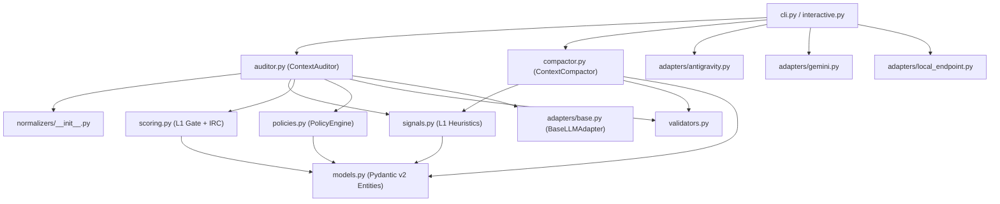

# Ultra Thinking Implementation Plan (v3.0.0) — Context Entropy Auditor (CEA) v3.1

> [!IMPORTANT]
> ### `WORKER EXECUTION DIRECTIVE (TARGET: GEMINI 3.8 FLASH)`
> This specification has been syntactically decompiled by the Principal Architect (`Argon 4`) under the **Architect-to-Flash Bridge** protocol. The tactical execution worker (`Gemini 3.8 Flash Low/Medium/High`) MUST obey the following deterministic execution loop:
> 1. **Sequential Packet Execution:** Process the Work Breakdown Structure strictly one Flash Execution Packet at a time (`FEP-001` $\to$ execute `verification_cmd` $\to$ verify `exit code 0` $\to$ advance to `FEP-002`).
> 2. **Zero-Context Bleeding:** For each `FEP-###`, load and read **ONLY** the repository-relative files explicitly listed in `read_context` and the frozen signatures in Section 5 (`REG-FROZEN-SIGNATURES`). Do not scan or assume external repository state outside `read_context`.
> 3. **Strict Write Isolation:** Create or modify **ONLY** the exact repository-relative paths listed in `write_targets` (zero glob wildcards permitted).
> 4. **Signature Immutability:** Never alter method names, parameter names, type annotations, default values, or return types declared under `REG-FROZEN-SIGNATURES`.

## Executive Orientation
Evolucionar **Context Entropy Auditor (CEA)** de una suite de diagnóstico pasivo (v0.5.0 / Seed v3.0) a un **Kernel / Gateway Transversal de Observabilidad Contextual (v3.1)** `[REQUIRED]`. La arquitectura introduce un pipeline de evaluación híbrido en dos fases (**L1 Heurístico Determinista $\le 15\text{ ms}$** sobre ventanas de $128\text{k}$ tokens y **L2 Semántico Condicional**), compresión rápida `zlib` (`level=1`) con Distancia de Compresión Normalizada (NCD) selectiva, detección de sesgo posicional (*Lost-in-the-Middle*), auditoría epistémicamente válida de volatilidad de prefijo (`[INV-02]`), gobernanza de ciclo de vida de sesión e inmutabilidad en compactación (`ContextCompactor`), adaptador universal HTTP local (`LocalEndpointAdapter`) con librería estándar (`urllib.request`) y cierre de brechas de superficie de tensión (`AGENTS.md`, `run_audit.sh`, `.github/workflows/ci.yml`, y escritura atómica en `BenchmarkSession.save_snapshot()`).

## User Review Required

> [!IMPORTANT]
> **Decisiones Críticas de Diseño y Compatibilidad de Esquemas Detectadas en Forense (`[OBSERVED]`):**
> 1. **Cuantización de las 6 Dimensiones Core (`AR-001`):** En [audit-result.schema.json](file:///d:/0001%20HyperScale%20Thinking/PROYECTOS%20CLOUD/Research%20and%20Development/CEA%20BRAIN/schemas/audit-result.schema.json#L27-L32) y en [test_validators.py](file:///d:/0001%20HyperScale%20Thinking/PROYECTOS%20CLOUD/Research%20and%20Development/CEA%20BRAIN/tests/unit/test_validators.py#L74-L94), las 6 dimensiones principales (`instruction_conflict`, `task_ambiguity`, `context_contamination`, `evidence_quality`, `state_integrity`, `redundancy_pressure`) y `Finding.severity` exigen el conjunto discreto `enum: [0, 25, 50, 75, 100]`. Por tanto, `synthesize_l1_dimension_scores()` cuantizará las 6 dimensiones base al escalón discreto más cercano $\in \{0, 25, 50, 75, 100\}$, mientras que las 3 nuevas sub-métricas opcionales (`lexical_redundancy`, `positional_decay`, `prefix_volatility`) operarán como enteros continuos `[0, 100]` (`{"type": ["integer", "null"], "minimum": 0, "maximum": 100}`).
> 2. **Serialización de Campos Opcionales (`AR-002`):** Dado que [auditor.py](file:///d:/0001%20HyperScale%20Thinking/PROYECTOS%20CLOUD/Research%20and%20Development/CEA%20BRAIN/src/context_auditor/auditor.py#L66) invoca `validate_result(result.model_dump())` sin `exclude_none=True`, las propiedades opcionales nuevas en `schemas/audit-result.schema.json` (`lexical_redundancy`, `positional_decay`, `prefix_volatility` y `l1_verdict`) se declaran aceptando `null` (`["integer", "null"]` y `["object", "null"]`) para preservar 100% de retrocompatibilidad con los 36 tests existentes.
> 3. **Corrección de Defecto Latente en CLI Interactivo (`AR-005`):** En [interactive.py](file:///d:/0001%20HyperScale%20Thinking/PROYECTOS%20CLOUD/Research%20and%20Development/CEA%20BRAIN/src/context_auditor/interactive.py#L518-L519) existe una referencia a `f.remediation` sobre objetos `Finding` (cuyo modelo en `models.py` no posee el atributo `remediation`). Se corrige en `FEP-004` para evitar `AttributeError` al renderizar hallazgos L1/L2.

---

## 0. Context Qualification & Evidence Register
- **Operating Environment Mode (`REG-INPUT-QUALIFICATION`):** `Mode A (Live Environment)` `[OBSERVED]`. El repositorio fue inspeccionado directamente en `d:/0001 HyperScale Thinking/PROYECTOS CLOUD/Research and Development/CEA BRAIN`.
- **System Stack (`[OBSERVED]`):**
  - **Lenguaje y Runtime:** Python `3.12.10` (`requires-python >= 3.9` en `pyproject.toml`) `[OBSERVED]`.
  - **Dependencias de Producción:** `pydantic>=2.0.0`, `jsonschema>=4.0.0`, `pyyaml>=6.0` (Cero SDKs propietarios obligatorios en el core) `[OBSERVED]`.
  - **Framework de Pruebas:** `pytest 9.1.1` (`pytest>=7.0.0` en `pyproject.toml`) `[OBSERVED]`.
  - **Almacenamiento / Estado:** Core 100% stateless; snapshots de benchmark en sistema de archivos local (`./logs/benchmarks/<session_id>/`) `[OBSERVED]`.

### Epistemic Evidence Register

| Fuente / Artefacto | Ruta Relativa | Estado Epistémico | Evidencia Extraída |
|:---|:---|:---:|:---|
| Manifiesto de Paquete | `./pyproject.toml` | `[OBSERVED]` | Versión `0.5.0`, dependencias `pydantic>=2.0.0`, `jsonschema>=4.0.0`, `pyyaml>=6.0`. |
| Modelos de Dominio | `./src/context_auditor/models.py` | `[OBSERVED]` | 97 líneas; define `AuditInput`, `AuditResult`, `DimensionScores`, `Finding`, `RecommendedAction`. |
| Motor de Señales L1 | `./src/context_auditor/signals.py` | `[OBSERVED]` | 75 líneas; implementa `estimate_tokens` y `extract_deterministic_signals` con 7 métricas básicas. |
| Motor de Scoring IRC | `./src/context_auditor/scoring.py` | `[OBSERVED]` | 73 líneas; implementa `load_scoring_config`, `compute_base_status` y `compute_irc`. |
| Orquestador | `./src/context_auditor/auditor.py` | `[OBSERVED]` | 68 líneas; acoplado siempre a `self.llm_adapter.evaluate_context()` sin bypass L1. |
| Motor de Políticas | `./src/context_auditor/policies.py` | `[OBSERVED]` | 34 líneas; define `PolicyMode` y `PolicyEngine.process_actions`. |
| Sesión Interactiva | `./src/context_auditor/interactive.py` | `[OBSERVED]` | 566 líneas; `save_snapshot()` usa `.write_text()` directo no atómico; línea 518 referencia `f.remediation` inexistente. |
| Contrato JSON Salida | `./schemas/audit-result.schema.json` | `[OBSERVED]` | 88 líneas; exige `enum: [0, 25, 50, 75, 100]` en las 6 dimensiones principales y `Finding.severity`. |
| Topología iDirectory | `./.context/tree.json` | `[OBSERVED]` | Declara `AGENTS.md` en `bootloader.tier_1` y `bootloader.tier_2`, pero el archivo no existe en raíz. |
| Memoria Técnica Seed | `./01_seed/seed-context-entropy-auditor-master.md` | `[OBSERVED_IN_SEED]` | Documenta 36 tests unitarios/E2E y la superficie de tensión en Sección 7.1 y deuda en Sección 9.2. |

---

## 1. Repository Forensics & Baseline

### 1.1 Baseline Verificado en Vivo (`[OBSERVED]`)
- **Runtime Python:** `Python 3.12.10` sobre `win32`, `pytest-9.1.1`, **36/36 tests PASSED en 6.38s** `[OBSERVED]`.
- **Estructura Actual de Módulos (`src/context_auditor/`):**
  - [models.py](file:///d:/0001%20HyperScale%20Thinking/PROYECTOS%20CLOUD/Research%20and%20Development/CEA%20BRAIN/src/context_auditor/models.py): Carece de `GateRoute`, `L1GateVerdict` y sub-métricas opcionales en `DimensionScores` `[OBSERVED]`.
  - [signals.py](file:///d:/0001%20HyperScale%20Thinking/PROYECTOS%20CLOUD/Research%20and%20Development/CEA%20BRAIN/src/context_auditor/signals.py): Utiliza `estimate_tokens("a" * total_chars)` y verifica duplicados exactos por igualdad de strings en memoria (`doc.content in content_hashes`), careciendo de compresión `zlib`, NCD, análisis posicional (*Lost-in-the-Middle*), auditoría de prefijo y verificación de deriva JSON en herramientas `[OBSERVED]`.
  - [auditor.py](file:///d:/0001%20HyperScale%20Thinking/PROYECTOS%20CLOUD/Research%20and%20Development/CEA%20BRAIN/src/context_auditor/auditor.py): Invoca incondicionalmente `self.llm_adapter.evaluate_context(audit_input, signals)` en cada llamada a `audit()`, impidiendo operar como *Fast Gate* determinista en $\le 15\text{ ms}$ `[OBSERVED]`.
  - [interactive.py](file:///d:/0001%20HyperScale%20Thinking/PROYECTOS%20CLOUD/Research%20and%20Development/CEA%20BRAIN/src/context_auditor/interactive.py): `BenchmarkSession.save_snapshot()` escribe directamente sobre `session_meta.json`, `conversation.json`, `timeline.json` y `summary_report.md` sin archivo temporal `.tmp` ni `os.replace()` (Deuda `M06-C02`) `[OBSERVED]`.

### 1.2 Inventario de Obligaciones de Compatibilidad Pública (`C-###`)
- **`C-001` (`ContextAuditor.audit`):** La firma `audit(self, raw_input: Dict[str, Any], task_requires_factual: bool = False, fast_gate_only: bool = False, force_semantic: bool = False) -> AuditResult` mantiene los valores por defecto posicionales y nominales para no romper `scripts/evaluate.py`, `cli.py`, `interactive.py` ni tests existentes `[REQUIRED]`.
- **`C-002` (`resolve_adapter` en `cli.py`):** La firma `resolve_adapter(adapter_name: Optional[str] = None, model: Optional[str] = None, effort: str = "medium", agy_path: str = "agy.exe", endpoint_url: Optional[str] = None) -> BaseLLMAdapter` conserva compatibilidad exacta con `test_resolve_adapter_options` en [test_antigravity_adapter.py](file:///d:/0001%20HyperScale%20Thinking/PROYECTOS%20CLOUD/Research%20and%20Development/CEA%20BRAIN/tests/unit/test_antigravity_adapter.py#L218-L227) `[OBSERVED]`.
- **`C-003` (`compute_irc` en `scoring.py`):** Mantiene intactos sus parámetros `(dimensions: DimensionScores, evidence_coverage: float, task_requires_factual: bool = False)` y su tupla de retorno `(float, OverallStatus, list[str])` `[OBSERVED]`.
- **`C-004` (`schemas/audit-result.schema.json`):** Mantiene `enum: [0, 25, 50, 75, 100]` en las 6 dimensiones principales para que `test_validate_result_invalid_severity` en [test_validators.py](file:///d:/0001%20HyperScale%20Thinking/PROYECTOS%20CLOUD/Research%20and%20Development/CEA%20BRAIN/tests/unit/test_validators.py#L74-L94) continúe pasando sin alteración `[OBSERVED]`.

---

## 2. Requirement Traceability & Gap Analysis

### 2.1 Matriz de Trazabilidad Completa (`R-###`)

| ID | Source Tag | Requirement | Baseline State | Gap | Decision | WBS Phase / FEP-ID | Verification Test | Migration |
|:---|:---:|:---|:---|:---|:---|:---:|:---|:---|
| `R-001` | `[REQUIRED]` | Redundancia léxica por compresión rápida `zlib` (`level=1`, `Z_BEST_SPEED`) en `< 2.5ms` para 512 KB | Ausente en `signals.py` | Sin medición de compresibilidad léxica | Implementar `compute_compression_redundancy` | `FEP-001` | `tests/unit/test_signals.py::test_compression_redundancy_and_latency` | Additive |
| `R-002` | `[REQUIRED]` | Distancia de Compresión Normalizada (`compute_pairwise_ncd`) con pre-filtro de diferencia de longitud $> 20\%$ | Solo igualdad exacta de strings en `signals.py` | No detecta cuasi-duplicados documentales | Implementar `compute_pairwise_ncd` con `zlib` `level=1` | `FEP-001` | `tests/unit/test_signals.py::test_compute_pairwise_ncd` | Additive |
| `R-003` | `[REQUIRED]` | Analizador de dispersión posicional (*Lost-in-the-Middle*, $0.35 \le p \le 0.75$) para directivas `Role.SYSTEM` y restricciones negativas | Ausente en `signals.py` | Sin cálculo de offset relativo $p$ | Implementar `analyze_positional_bias` | `FEP-001` | `tests/unit/test_signals.py::test_analyze_positional_bias_middle_zone` | Additive |
| `R-004` | `[REQUIRED]` | Auditor epistémicamente válido de volatilidad de prefijo ($p < 0.15$) con regex ISO-8601/UUIDv4/hashes y comparación opcional de `previous_prefix_hash` | Ausente en `signals.py` | Sin telemetría de churn de prefijo | Implementar `audit_prefix_stability` respetando `INV-02` | `FEP-001` | `tests/unit/test_signals.py::test_audit_prefix_stability_with_and_without_prev_hash` | Additive |
| `R-005` | `[REQUIRED]` | Rastreador simbólico de deriva de estado de herramientas (`track_tool_state_drift`) con extracción JSON de 1er nivel y detección de IDs fantasma | Solo conteo de `superseded_tool_results` | No inspecciona claves JSON ni IDs inexistentes | Implementar `track_tool_state_drift` e integrar en `extract_deterministic_signals` | `FEP-001` | `tests/unit/test_signals.py::test_track_tool_state_drift_json_and_phantom_ids` | Additive |
| `R-006` | `[REQUIRED]` | Configuración de umbrales `l1_gate_thresholds` y pesos heurísticos en `config/scoring_defaults.yaml` | Solo `weights`, `thresholds`, `override_rules` | Faltan umbrales deterministas L1 | Extender `config/scoring_defaults.yaml` | `FEP-001` | `tests/unit/test_signals.py::test_l1_latency_budget_512kb` | Additive |
| `R-007` | `[REQUIRED]` | Extender `models.py` con `GateRoute`, `L1GateVerdict`, sub-métricas opcionales en `DimensionScores` y `l1_verdict` en `AuditResult` | Modelos v1.0 básicos | Sin tipos para veredicto L1 ni sub-métricas | Actualizar `models.py` con defaults `None` | `FEP-002` | `tests/unit/test_validators.py::test_validate_result_with_l1_verdict_and_submetrics` | Backward-compatible |
| `R-008` | `[REQUIRED]` | Sincronizar `schemas/audit-result.schema.json` con sub-métricas opcionales y `l1_verdict` | Esquema sin campos L1 | Desincronización potencial con `model_dump()` | Actualizar `schemas/audit-result.schema.json` permitiendo `null` en opcionales | `FEP-002` | `tests/unit/test_validators.py::test_validate_result_with_l1_verdict_and_submetrics` | Backward-compatible |
| `R-009` | `[REQUIRED]` | Implementar `synthesize_l1_dimension_scores` y `compute_l1_gate` en `scoring.py` | Solo `compute_irc` en `scoring.py` | Sin síntesis heurística L1 ni router | Implementar ambas funciones puras en `scoring.py` | `FEP-003` | `tests/unit/test_scoring.py::test_synthesize_l1_dimension_scores_and_gate` | Additive |
| `R-010` | `[REQUIRED]` | Refactorizar `ContextAuditor.audit()` con enrutamiento condicional L1/L2 (`fast_gate_only`, `force_semantic`, `GateRoute.PASS`) | Invoca LLM en el 100% de los casos | Sin bypass determinista L1 | Actualizar `ContextAuditor.audit()` en `auditor.py` | `FEP-003` | `tests/unit/test_scoring.py::test_auditor_l1_pass_bypasses_llm_adapter` | Backward-compatible |
| `R-011` | `[REQUIRED]` | Definir acciones canónicas de ciclo de vida y `PolicyEngine.can_execute_compaction` en `policies.py` | Solo `process_actions` en `policies.py` | Sin guardrails de ejecución de compactación | Extender `policies.py` | `FEP-004` | `tests/unit/test_policies.py::test_can_execute_compaction_modes` | Additive |
| `R-012` | `[REQUIRED]` | Implementar motor inmutable `ContextCompactor` en `src/context_auditor/compactor.py` (`prune_stale_tools`, `deduplicate_documents`, `reanchor_instructions`, `generate_handoff_payload`) | Módulo inexistente | Sin remediación/compactación inmutable | Crear `src/context_auditor/compactor.py` validando con `validate_input` | `FEP-004` | `tests/unit/test_compactor.py::test_compactor_immutability_and_schema_compliance` | New module |
| `R-013` | `[REQUIRED]` | Escritura atómica (`.tmp` + `os.replace`) en `BenchmarkSession.save_snapshot()`, tracking de `last_prefix_hash` y opción de compactación supervisada en `interactive.py` | Escritura directa `.write_text()` | Riesgo de corrupción de JSON (Deuda `M06-C02`) | Actualizar `src/context_auditor/interactive.py` | `FEP-004` | `tests/unit/test_interactive_session.py::test_atomic_save_snapshot_and_prefix_hash` | Backward-compatible |
| `R-014` | `[REQUIRED]` | Implementar `LocalEndpointAdapter` en `src/context_auditor/adapters/local_endpoint.py` usando exclusivamente `urllib.request` / `urllib.error` | Sin adaptador HTTP local genérico | Acoplado a `agy.exe` o `GeminiAdapter` | Crear `local_endpoint.py` y exportar en `adapters/__init__.py` | `FEP-005` | `tests/unit/test_local_endpoint_adapter.py::test_local_endpoint_adapter_success_and_errors` | New module |
| `R-015` | `[REQUIRED]` | Hardening de `AntigravityAdapter` separando estrictamente `stdout` y `stderr` y decodificación UTF-8 segura | `capture_output=True` básico | Contaminación potencial o errores de decodificación | Asegurar aislamiento de `stdout`/`stderr` y `errors="replace"` en `antigravity.py` | `FEP-005` | `tests/unit/test_antigravity_adapter.py::test_antigravity_adapter_stderr_isolation` | Backward-compatible |
| `R-016` | `[REQUIRED]` | Extender `cli.py` para soportar `--adapter local_endpoint`, `--endpoint-url`, `--fast-gate-only` y `--force-semantic` | Solo `--adapter gemini|antigravity` | CLI no expone nuevos flags ni `LocalEndpointAdapter` | Actualizar `resolve_adapter` y `main` en `cli.py` | `FEP-005` | `tests/e2e/test_cli.py::test_cli_fast_gate_only` | Backward-compatible |
| `R-017` | `[REQUIRED]` | Crear `./AGENTS.md` sincronizado con `.context/tree.json`, `./run_audit.sh` POSIX y `./.github/workflows/ci.yml` | Archivos ausentes (`[FALTANTE]` en Seed 7.1) | Fallo de bootloader Tier 1/2 y ausencia de CI | Crear los 3 archivos y sincronizar Seed v3.1 | `FEP-006`, `FEP-007` | `tests/e2e/test_cli.py::test_governance_files_exist` | New files |

### 2.2 Verificación de Compuertas de Huérfanos (`REG-ORPHAN-GATES`)
- **Orphan Requirements Gate ($\mathcal{I}_{\text{orphan\_req}} = 0$):** Los 17 requerimientos (`R-001` a `R-017`) poseen asignación explícita de `FEP-###` y test de verificación automatizado `[DERIVED]`.
- **Orphan Components Gate ($\mathcal{I}_{\text{orphan\_comp}} = 0$):** Todos los componentes marcados como `[NEW]` en la Sección 4 referencian explícitamente su requerimiento `R-###` e invariante `INV-###` `[DERIVED]`.

---

## 3. Architectural Alternatives, Decisions & Invariants

### 3.1 Análisis de Alternativas Descartadas
1. **Compresión Léxica (`lzma` / `bz2` vs `zlib` `level=1`):**
   - *Alternativa descartada:* `lzma` o `zlib` `level=9`. Aunque ofrecen mayor ratio de compresión asintótico, su latencia en payloads de $512\text{ KB}$ oscila entre $18\text{ ms}$ y $65\text{ ms}$, violando `[INV-05]` ($\le 15\text{ ms}$).
   - *Selección:* `zlib.compress(data, level=1)` (`Z_BEST_SPEED`), que procesa $512\text{ KB}$ en $\approx 1.2\text{ ms}$ en C nativo dentro de la librería estándar de Python `[DERIVED]`.
2. **Cliente HTTP en `LocalEndpointAdapter` (`httpx` / `requests` vs `urllib.request`):**
   - *Alternativa descartada:* Añadir `httpx` o `requests` a `pyproject.toml`. Violaría la restricción de cero dependencias externas adicionales (`CRIT-06`).
   - *Selección:* `urllib.request.Request` y `urllib.request.urlopen` de la librería estándar de Python `[REQUIRED]`.
3. **Mutación In-Place vs Copia Profunda en `ContextCompactor`:**
   - *Alternativa descartada:* Modificar listas `audit_input.messages` y `audit_input.tool_events` in-place. Violaría `[INV-03]` y corrompería referencias del llamador en sesiones interactivas.
   - *Selección:* `cloned = audit_input.model_copy(deep=True)` seguido de validación contractual estricta vía `validate_input(cloned.model_dump(mode="json"))` `[REQUIRED]`.

### 3.2 Architectural Decision Records (`ADR-###`)
- **`ADR-007` (Two-Phase L1/L2 Gating Pipeline):** Desacoplar la auditoría en un filtro determinista rápido L1 (`compute_l1_gate` $\le 15\text{ ms}$) que resuelve contextos saludables (`GateRoute.PASS`) o con saturación obvia (`GateRoute.REMEDIATE_FIRST`) sin invocar LLMs, reservando la inferencia semántica L2 para casos ambiguos (`GateRoute.FORCE_L2_AUDIT`) o tareas factuales (`task_requires_factual=True`) `[REQUIRED]`.
- **`ADR-008` (Epistemic Prefix Stability Telemetry):** Auditar la estabilidad del bloque inicial ($p < 0.15$) reportando únicamente patrones volátiles observables en texto (`static_prefix_volatility_detected: bool`) y comparando hashes SHA-256 entre turnos (`observed_prefix_churn: Optional[bool]`) exclusivamente cuando `runtime_telemetry` incluye `previous_prefix_hash` `[REQUIRED]`.
- **`ADR-009` (Dual-Array Synchronization in ContextCompactor):** Al podar salidas de herramientas antiguas (`prune_stale_tools`), sincronizar atómicamente tanto `cloned.tool_events` como los mensajes con `role == Role.TOOL` en `cloned.messages` mediante el marcador canónico `[RESULT_COMPACTED_BY_CEA: id=<id>, tool=<name>]` `[REQUIRED]`.

### 3.3 Invariant Ledger (`INV-###`)

| Invariant ID | Mathematical / Logical Rule | Automated Enforcement Mechanism | Failure Action |
|:---:|:---|:---|:---|
| `INV-01` | **Independencia del Core:** `models.py`, `signals.py`, `scoring.py` y `compactor.py` jamás importan SDKs de inferencia (`google.genai`, `openai`, `anthropic`). | Inspección AST de imports en `tests/unit/test_signals.py` y `tests/unit/test_compactor.py`. | Fallo de test unitario en CI (`exit code 1`). |
| `INV-02` | **Contrato Epistémico Absoluto:** Si `"previous_prefix_hash" not in runtime_telemetry`, `observed_prefix_churn` DEBE ser `None`. Todo hallazgo generado en L1 lleva `EpistemicStatus.RUNTIME_MEASURED`. | Aserción explícita en `test_audit_prefix_stability_with_and_without_prev_hash` y `test_auditor_l1_pass_bypasses_llm_adapter`. | Rechazo de validación epistémica (`AssertionError`). |
| `INV-03` | **Pureza Matemática e Inmutabilidad:** Para toda operación $f \in \text{ContextCompactor}$, $\text{id}(f(x)) \neq \text{id}(x)$ y $x_{\text{post}} == x_{\text{pre}}$. | Test de igualdad profunda pre/post ejecución en `tests/unit/test_compactor.py`. | Fallo inmediato en suite unitaria. |
| `INV-04` | **Bidireccionalidad de Esquemas:** Todo `AuditInput` compactado valida contra `audit-input.schema.json` y todo `AuditResult` (L1 o L2) valida contra `audit-result.schema.json`. | Llamadas obligatorias a `validate_input()` en `ContextCompactor` y `validate_result()` en `ContextAuditor.audit()`. | Excepción `jsonschema.ValidationError`. |
| `INV-05` | **Zero Latency Impact:** $T(\text{extract\_deterministic\_signals}) + T(\text{compute\_l1\_gate}) \le 15.0\text{ ms}$ en payloads de $128\text{k}$ tokens ($\approx 512\text{ KB}$) con `zlib` `level=1`. | Benchmark determinista con `time.perf_counter()` en `tests/unit/test_signals.py`. | Fallo de presupuesto de latencia en test. |

---

## 4. Target Architecture & Dependency Boundaries

### 4.1 Árbol de Directorios Objetivo con Etiquetas AST

```text
./
├── .github/
│   └── workflows/
│       └── ci.yml                                      [NEW] (R-017, INV-04: Pipeline CI multi-OS Python 3.9-3.12)
├── 01_seed/
│   └── seed-context-entropy-auditor-master.md          [MODIFY] (R-017, INV-04: Sincronización AST y cierre de hallazgos v3.1)
├── AGENTS.md                                           [NEW] (R-017, INV-04: Bootloader Tier 1/2 exigido por .context/tree.json)
├── config/
│   └── scoring_defaults.yaml                           [MODIFY] (R-006, INV-05: Umbrales l1_gate_thresholds y pesos heurísticos)
├── run_audit.ps1                                       [PRESERVE]
├── run_audit.sh                                        [NEW] (R-017, INV-01: Launcher POSIX con paridad funcional respecto a run_audit.ps1)
├── schemas/
│   ├── audit-input.schema.json                         [PRESERVE]
│   └── audit-result.schema.json                        [MODIFY] (R-008, INV-04: Sub-métricas opcionales y objeto l1_verdict)
├── src/
│   └── context_auditor/
│       ├── __init__.py                                 [PRESERVE]
│       ├── auditor.py                                  [MODIFY] (R-010, INV-02, INV-04: Enrutamiento condicional L1/L2)
│       ├── cli.py                                      [MODIFY] (R-016, C-002: Flags --endpoint-url, --fast-gate-only, --force-semantic)
│       ├── compactor.py                                [NEW] (R-012, INV-01, INV-03, INV-04: Motor inmutable ContextCompactor)
│       ├── interactive.py                              [MODIFY] (R-013, INV-02: Escritura atómica os.replace, prefix hash y compactación)
│       ├── models.py                                   [MODIFY] (R-007, INV-01, INV-04: GateRoute, L1GateVerdict, DimensionScores extendido)
│       ├── policies.py                                 [MODIFY] (R-011, INV-03: Constantes canónicas y can_execute_compaction)
│       ├── scoring.py                                  [MODIFY] (R-009, INV-01, INV-03: synthesize_l1_dimension_scores y compute_l1_gate)
│       ├── signals.py                                  [MODIFY] (R-001..R-005, INV-01..INV-05: Zlib, NCD, Lost-in-the-Middle, Prefix, Drift)
│       ├── validators.py                               [PRESERVE]
│       ├── adapters/
│       │   ├── __init__.py                             [MODIFY] (R-014: Exportación de LocalEndpointAdapter)
│       │   ├── antigravity.py                          [MODIFY] (R-015: Aislamiento estricto stdout/stderr y UTF-8 replace)
│       │   ├── base.py                                 [PRESERVE]
│       │   ├── gemini.py                               [PRESERVE]
│       │   └── local_endpoint.py                       [NEW] (R-014, INV-01: Adaptador HTTP local vía urllib.request estándar)
│       └── normalizers/
│           └── __init__.py                             [PRESERVE]
└── tests/
    ├── e2e/
    │   └── test_cli.py                                 [MODIFY] (R-016, R-017: Tests de CLI fast-gate-only y existencia de artefactos)
    └── unit/
        ├── test_antigravity_adapter.py                 [MODIFY] (R-015: Test de aislamiento de warnings en stderr)
        ├── test_compactor.py                           [NEW] (R-012, INV-03, INV-04: Tests de inmutabilidad y sincronización de ContextCompactor)
        ├── test_interactive_session.py                 [MODIFY] (R-013: Tests de escritura atómica y previous_prefix_hash)
        ├── test_local_endpoint_adapter.py              [NEW] (R-014: Tests unitarios con mocks de urllib.request.urlopen)
        ├── test_normalizers.py                         [PRESERVE]
        ├── test_policies.py                            [MODIFY] (R-011: Tests de can_execute_compaction y acciones canónicas)
        ├── test_scoring.py                             [MODIFY] (R-009, R-010: Tests de síntesis L1, compute_l1_gate y bypass L2)
        ├── test_signals.py                             [MODIFY] (R-001..R-006, INV-05: Tests de Zlib, NCD, sesgo posicional, prefijo y latencia <=15ms)
        └── test_validators.py                          [MODIFY] (R-008, INV-04: Tests de validación con l1_verdict y sub-métricas)
```

### 4.2 Fronteras de Acoplamiento y Grafo de Dependencias



- **Regla de Frontera Estricta (`[INV-01]`):** `models.py`, `signals.py`, `scoring.py`, `policies.py`, `validators.py` y `compactor.py` tienen prohibido importar desde `src.context_auditor.adapters.*` o SDKs externos de inferencia.

---

## 5. Contract, Interface & Data Specifications (`REG-FROZEN-SIGNATURES`)

> [!CAUTION]
> **REGLA DE INMUTABILIDAD DE FIRMAS (`REG-FROZEN-SIGNATURES`):** Los trabajadores tácticos (`Gemini 3.8 Flash`) tienen estrictamente prohibido alterar los nombres de funciones, clases, atributos, tipos de argumentos, valores por defecto o tipos de retorno declarados en los siguientes bloques literales.

### 5.1 Contrato de Modelos (`./src/context_auditor/models.py`) — `R-007`, `INV-01`, `INV-04`

```python
from enum import Enum
from typing import List, Dict, Any, Optional
from pydantic import BaseModel, Field
from datetime import datetime


class Role(str, Enum):
    SYSTEM = "system"
    USER = "user"
    ASSISTANT = "assistant"
    TOOL = "tool"


class GateRoute(str, Enum):
    PASS = "pass"
    FORCE_L2_AUDIT = "force_l2_audit"
    REMEDIATE_FIRST = "remediate_first"
    CIRCUIT_BREAKER_HALT = "circuit_breaker_halt"


class Message(BaseModel):
    id: str
    role: Role
    content: str
    timestamp: Optional[datetime] = None


class Document(BaseModel):
    id: str
    content: str
    source: Optional[str] = None
    confidence: Optional[float] = Field(None, ge=0.0, le=1.0)


class ToolEvent(BaseModel):
    id: str
    tool_name: str
    parameters: Dict[str, Any]
    result: str
    timestamp: Optional[datetime] = None


class AuditInput(BaseModel):
    schema_version: str = "1.0.0"
    messages: List[Message]
    documents: List[Document] = Field(default_factory=list)
    tool_events: List[ToolEvent] = Field(default_factory=list)
    runtime_telemetry: Dict[str, Any] = Field(default_factory=dict)
    audit_configuration: Dict[str, Any] = Field(default_factory=dict)


class OverallStatus(str, Enum):
    STABLE = "stable"
    MODERATE = "moderate"
    HIGH = "high"
    CRITICAL = "critical"


class EpistemicStatus(str, Enum):
    OBSERVED = "observed"
    INFERRED = "inferred"
    RUNTIME_MEASURED = "runtime_measured"
    UNKNOWN = "unknown"


class AuditScope(BaseModel):
    messages_observed: Optional[int] = None
    documents_observed: Optional[int] = None
    tool_outputs_observed: Optional[int] = None


class DimensionScores(BaseModel):
    instruction_conflict: int
    task_ambiguity: int
    context_contamination: int
    evidence_quality: int
    state_integrity: int
    redundancy_pressure: int
    lexical_redundancy: Optional[int] = Field(default=None, ge=0, le=100)
    positional_decay: Optional[int] = Field(default=None, ge=0, le=100)
    prefix_volatility: Optional[int] = Field(default=None, ge=0, le=100)


class L1GateVerdict(BaseModel):
    route: GateRoute
    l1_risk_score: float = Field(..., ge=0.0, le=100.0)
    triggers: List[str] = Field(default_factory=list)
    latency_ms: float = Field(..., ge=0.0)


class Finding(BaseModel):
    finding_id: str
    dimension: str
    epistemic_status: EpistemicStatus
    severity: int
    evidence_refs: List[str]
    explanation: str
    confidence: Optional[float] = Field(None, ge=0.0, le=1.0)


class RecommendedAction(BaseModel):
    action: str
    target_refs: List[str] = Field(default_factory=list)
    reason: str
    requires_policy_approval: bool
    destructive: bool


class AuditResult(BaseModel):
    schema_version: str = "1.0.0"
    audit_version: Optional[str] = None
    audit_id: str
    overall_status: OverallStatus
    risk_score: float = Field(..., ge=0.0, le=100.0)
    confidence: float = Field(..., ge=0.0, le=1.0)
    evidence_coverage: float = Field(..., ge=0.0, le=1.0)
    scope: Optional[AuditScope] = None
    dimension_scores: DimensionScores
    findings: List[Finding]
    recommended_actions: List[RecommendedAction] = Field(default_factory=list)
    triggered_rules: List[str] = Field(default_factory=list)
    limitations: List[str]
    l1_verdict: Optional[L1GateVerdict] = None
```

### 5.2 Contrato del Motor Determinista L1 (`./src/context_auditor/signals.py`) — `R-001` a `R-005`, `INV-02`, `INV-05`

```python
import hashlib
import json
import re
import time
import zlib
from typing import Dict, Any, List, Optional
from src.context_auditor.models import AuditInput, Message, Document, ToolEvent, Role

def estimate_tokens(text: str) -> int:
    """Fallback deterministic token estimator (~4 chars per token)."""

def compute_compression_redundancy(text: str) -> float:
    """Computes lexical redundancy in [0.0, 1.0] via zlib level=1 (Z_BEST_SPEED)."""

def compute_pairwise_ncd(text_a: str, text_b: str) -> float:
    """Computes Normalized Compression Distance in [0.0, 1.0] with 20% length pre-filter."""

def analyze_positional_bias(messages: List[Message], documents: List[Document]) -> Dict[str, Any]:
    """Detects Role.SYSTEM or negative constraints displaced into [0.35, 0.75] relative token window."""

def audit_prefix_stability(messages: List[Message], runtime_telemetry: Dict[str, Any]) -> Dict[str, Any]:
    """Audits p < 0.15 prefix block for static volatility and optional inter-turn SHA-256 churn."""

def track_tool_state_drift(messages: List[Message], tool_events: List[ToolEvent]) -> Dict[str, Any]:
    """Extracts top-level JSON keys from tool results and detects superseded calls or phantom tool IDs."""

def extract_deterministic_signals(audit_input: AuditInput) -> Dict[str, Any]:
    """Computes all L1 deterministic signals without invoking an LLM."""
```

**Especificación Matemática de `signals.py`:**
- `compute_compression_redundancy(text: str) -> float`:
  - Si `not text`, retorna `0.0`.
  - `raw_bytes = text.encode("utf-8")`; `compressed = zlib.compress(raw_bytes, level=1)`.
  - $\text{redundancy\_ratio} = \max\left(0.0, \min\left(1.0, 1.0 - \frac{\text{len}(\text{compressed})}{\max(\text{len}(\text{raw\_bytes}), 1)}\right)\right)$ redondeado a 4 decimales.
- `compute_pairwise_ncd(text_a: str, text_b: str) -> float`:
  - Si `not text_a and not text_b`, retorna `0.0`. Si uno es vacío y el otro no, retorna `1.0`.
  - Pre-filtro de complejidad: sean $L_a = \text{len}(text\_a)$, $L_b = \text{len}(text\_b)$. Si $\frac{|L_a - L_b|}{\max(L_a, L_b, 1)} > 0.20$, retorna `1.0` sin comprimir `a+b`.
  - Con `zlib.compress(raw_bytes, level=1)`: sean $C(a), C(b), C(ab)$ las longitudes en bytes comprimidos de $a$, $b$ y $a + b$.
  - $\text{NCD}(a, b) = \max\left(0.0, \min\left(1.0, \frac{C(ab) - \min(C(a), C(b))}{\max(C(a), C(b), 1)}\right)\right)$ redondeado a 4 decimales.
- `analyze_positional_bias(messages: List[Message], documents: List[Document]) -> Dict[str, Any]`:
  - Calcula tokens por elemento con `estimate_tokens()` y el total `total_tokens = max(sum_all_tokens, 1)`.
  - Para cada mensaje $m_i$, su posición relativa de inicio es $p_i = \frac{\text{offset\_tokens}_i}{\text{total\_tokens}} \in [0.0, 1.0]$.
  - Detecta si $0.35 \le p_i \le 0.75$ y (`m_i.role == Role.SYSTEM` o el contenido coincide con el patrón compilado `r"\b(?:MUST\s+NOT|PROHIBIDO|NEVER|DO\s+NOT)\b"`).
  - Retorna `{"mid_context_penalty": min(100, len(mid_refs) * 25), "mid_context_refs": mid_refs}`.
- `audit_prefix_stability(messages: List[Message], runtime_telemetry: Dict[str, Any]) -> Dict[str, Any]`:
  - Evalúa mensajes en el bloque inicial ($p_i < 0.15$, incluyendo siempre `messages[0]` si `messages` no está vacío).
  - Detecta patrones volátiles estáticos mediante regex compiladas:
    - ISO-8601: `r"\b\d{4}-\d{2}-\d{2}[T\s]\d{2}:\d{2}:\d{2}(?:\.\d+)?(?:Z|[+-]\d{2}:?\d{2})?\b"`
    - UUIDv4: `r"\b[0-9a-fA-F]{8}-[0-9a-fA-F]{4}-4[0-9a-fA-F]{3}-[89abAB][0-9a-fA-F]{3}-[0-9a-fA-F]{12}\b"`
    - Hashes hexadecimales efímeros ($\ge 32$ hex chars): `r"\b[0-9a-fA-F]{32,64}\b"`
  - Calcula `current_prefix_hash = hashlib.sha256(prefix_text.encode("utf-8")).hexdigest()`.
  - Cumplimiento estricto de `[INV-02]`: si `"previous_prefix_hash"` está en `runtime_telemetry` y no es `None`, `observed_prefix_churn = (runtime_telemetry["previous_prefix_hash"] != current_prefix_hash)`; en caso contrario, `observed_prefix_churn = None`.
  - Retorna `{"volatile_header_tokens": int, "current_prefix_hash": str, "observed_prefix_churn": Optional[bool], "static_prefix_volatility_detected": bool}`.
- `track_tool_state_drift(messages: List[Message], tool_events: List[ToolEvent]) -> Dict[str, Any]`:
  - Extrae claves de primer nivel si `t.result` es JSON dict válido.
  - Detecta llamadas reemplazadas (`superseded_tool_results`), referencias en mensajes `Role.ASSISTANT` a IDs `tool-\d+` o `t\d+` que no existen en `{t.id for t in tool_events}` (`phantom_tool_refs`), y contradicciones léxicas cuando una herramienta fue reemplazada o devolvió `"status": "error"` / `"error"` pero el asistente afirma éxito sin citar el último resultado.
  - Retorna `{"stale_tool_drift_detected": bool, "superseded_tool_results": int, "phantom_tool_refs": List[str], "parsed_tool_keys": Dict[str, List[str]]}`.

### 5.3 Contrato de Scoring L1 y Orquestador (`./src/context_auditor/scoring.py` y `./src/context_auditor/auditor.py`) — `R-009`, `R-010`

```python
# En ./src/context_auditor/scoring.py
from typing import Dict, Any, Tuple, List
from src.context_auditor.models import DimensionScores, OverallStatus, GateRoute, L1GateVerdict

def quantize_to_schema_enum(value: float) -> int:
    """Quantizes a continuous score [0, 100] to the nearest schema enum {0, 25, 50, 75, 100}."""
    clamped = max(0.0, min(100.0, float(value)))
    return int(min((0, 25, 50, 75, 100), key=lambda b: abs(b - clamped)))

def synthesize_l1_dimension_scores(signals: Dict[str, Any]) -> DimensionScores:
    """Maps L1 heuristic signals to quantized primary dimensions and continuous optional sub-metrics."""

def compute_l1_gate(signals: Dict[str, Any], config: Dict[str, Any]) -> L1GateVerdict:
    """Evaluates L1 deterministic triggers and returns GateRoute with risk score and latency_ms."""

def compute_irc(
    dimensions: DimensionScores,
    evidence_coverage: float,
    task_requires_factual: bool = False
) -> Tuple[float, OverallStatus, list[str]]:
    """Computes weighted linear IRC and applies safety override rules."""
```

```python
# En ./src/context_auditor/auditor.py
class ContextAuditor:
    def __init__(self, llm_adapter: BaseLLMAdapter, policy_mode: PolicyMode = PolicyMode.RECOMMEND):
        """Initializes ContextAuditor with LLM adapter and policy engine."""

    def audit(
        self,
        raw_input: Dict[str, Any],
        task_requires_factual: bool = False,
        fast_gate_only: bool = False,
        force_semantic: bool = False
    ) -> AuditResult:
        """Executes two-phase L1/L2 context audit and validates output against JSON Schema."""
```

### 5.4 Contrato de Gobernanza y Compactación Inmutable (`./src/context_auditor/policies.py` y `./src/context_auditor/compactor.py`) — `R-011`, `R-012`, `INV-03`, `INV-04`

```python
# En ./src/context_auditor/policies.py
SESSION_HANDOFF_CHECKPOINT = "session_handoff_checkpoint"
SESSION_FORK_CLEAN = "session_fork_clean"
PRUNE_STALE_TOOL_OUTPUTS = "prune_stale_tool_outputs"
DEDUPLICATE_DOCUMENTS = "deduplicate_documents"
REANCHOR_SYSTEM_INSTRUCTIONS = "reanchor_system_instructions"

class PolicyEngine:
    def __init__(self, mode: PolicyMode = PolicyMode.RECOMMEND):
        """Initializes PolicyEngine with active PolicyMode."""

    def process_actions(self, candidate_actions: List[RecommendedAction]) -> List[RecommendedAction]:
        """Filters and flags candidate actions according to active policy mode."""

    def can_execute_compaction(self, action: RecommendedAction, operator_confirmed: bool = False) -> bool:
        """Returns True only in DRY_RUN or when operator_confirmed=True in HUMAN_REVIEW/RECOMMEND."""
```

```python
# En ./src/context_auditor/compactor.py
from typing import List, Set
from src.context_auditor.models import AuditInput, Message, Document, ToolEvent, Role
from src.context_auditor.signals import compute_pairwise_ncd
from src.context_auditor.validators import validate_input

class ContextCompactor:
    def prune_stale_tools(self, audit_input: AuditInput, keep_recent: int = 3) -> AuditInput:
        """Deep-copies input, compacts old tool_events and matching Role.TOOL messages, and validates schema."""

    def deduplicate_documents(self, audit_input: AuditInput, ncd_threshold: float = 0.15) -> AuditInput:
        """Deep-copies input, removes exact SHA-256 and near-duplicate (NCD < threshold) documents."""

    def reanchor_instructions(self, audit_input: AuditInput) -> AuditInput:
        """Deep-copies input and inserts sys_reanchor_cea Role.SYSTEM message before last Role.USER turn."""

    def generate_handoff_payload(self, audit_input: AuditInput, state_summary: str) -> AuditInput:
        """Builds a clean checkpoint AuditInput preserving system instructions, deduplicated docs, and summary."""
```

### 5.5 Contrato de Adaptador Local Universal y CLI (`./src/context_auditor/adapters/local_endpoint.py` y `./src/context_auditor/cli.py`) — `R-014`, `R-016`

```python
# En ./src/context_auditor/adapters/local_endpoint.py
import json
import re
import urllib.error
import urllib.request
from pathlib import Path
from typing import Dict, Any, Optional
from src.context_auditor.adapters.base import BaseLLMAdapter, AdapterExecutionError
from src.context_auditor.models import AuditInput

class LocalEndpointAdapter(BaseLLMAdapter):
    def __init__(
        self,
        base_url: str = "http://localhost:11434/v1",
        model: str = "qwen2.5:7b",
        api_key: str = "not-needed",
        timeout: int = 60
    ):
        """Initializes OpenAI-compatible local HTTP adapter using Python stdlib urllib.request."""

    def evaluate_context(self, audit_input: AuditInput, signals: Dict[str, Any]) -> Dict[str, Any]:
        """POSTs chat completion request and extracts 4-layer defensive JSON or raises AdapterExecutionError."""
```

```python
# En ./src/context_auditor/cli.py
def resolve_adapter(
    adapter_name: Optional[str] = None,
    model: Optional[str] = None,
    effort: str = "medium",
    agy_path: str = "agy.exe",
    endpoint_url: Optional[str] = None
) -> BaseLLMAdapter:
    """Resolves AntigravityAdapter, LocalEndpointAdapter, or GeminiAdapter with full backward compatibility."""
```

### 5.6 Mapa Productor-Consumidor y Alineación de Prompt Caching
- **Productor `signals.py` $\to$ Consumidor `scoring.py` & `auditor.py`:** `extract_deterministic_signals` produce el diccionario de señales L1 consumido por `compute_l1_gate`, `synthesize_l1_dimension_scores` y los adaptadores L2.
- **Alineación de Prompt Caching (1,024 tokens):** `audit_prefix_stability` y `ContextCompactor.reanchor_instructions` preservan intacto el bloque inicial `Role.SYSTEM` ($p < 0.15$) e inyectan el recordatorio `sys_reanchor_cea` inmediatamente antes del último mensaje `Role.USER` (al final del contexto), evitando invalidar el KV Cache del prefijo del sistema `[DERIVED]`.

---

## 6. Failure, Security & Observability Architecture

### 6.1 Matriz de Fallos y Contención de Blast Radius

| Componente | Modo de Fallo | Mecanismo de Contención | Excepción / Fallback |
|:---|:---|:---|:---|
| `LocalEndpointAdapter` | Servidor local apagado (`URLError`), HTTP 4xx/5xx (`HTTPError`), timeout de socket o JSON malformado | Timeout explícito (`timeout=60`), captura de `urllib.error.URLError`, `HTTPError`, `TimeoutError` y extracción JSON en 4 capas | Lanza `AdapterExecutionError` descriptivo sin exponer credenciales |
| `AntigravityAdapter` | Warnings emitidos en `stderr` por `agy.exe` o bytes no UTF-8 | Separación estricta `result.stdout` vs `result.stderr` y `errors="replace"` | `_extract_json` procesa exclusivamente `result.stdout` |
| `BenchmarkSession.save_snapshot` | Interrupción de proceso o fallo de E/S a mitad de escritura de JSON | Escritura a archivo temporal `<target>.tmp` en el mismo directorio seguido de `os.replace()` atómico | El archivo previo permanece íntegro; limpieza de `.tmp` en bloque `finally` si falla |
| `signals.compute_pairwise_ncd` | Explosión cuadrática $O(N^2)$ en corpus con cientos de documentos | Pre-filtro de longitud ($\Delta L > 20\%$) y ventana máxima de comparación acotada a los primeros 25 documentos en `extract_deterministic_signals` | Mantiene latencia L1 $\le 15\text{ ms}$ (`[INV-05]`) |

### 6.2 Registro de Seguridad (`Zero-Trust`)
- **Enmascaramiento de Secretos:** Ningún adaptador ni log de benchmark persiste valores de `GEMINI_API_KEY` ni `api_key`. Cualquier cabecera `Authorization: Bearer <REDACTED>` se mantiene en memoria efímera de la petición `urllib.request.Request`.
- **Gobernanza de Compactación Destructiva:** `PolicyEngine.can_execute_compaction()` bloquea toda ejecución automática en modos `AUDIT_ONLY`, `RECOMMEND` y `HUMAN_REVIEW` salvo que `self.mode == PolicyMode.DRY_RUN` o `operator_confirmed=True` en modo `HUMAN_REVIEW`.

---

## 7. Phased Implementation Work Breakdown (WBS) — Flash Execution Packets (`FEP-###`)

### `FEP-001`: `L1 Deterministic Signals Expansion & Scoring Thresholds`
- `fep_id`: `FEP-001`
- `title`: `Expandir signals.py con Zlib L1, NCD, Lost-in-the-Middle, Prefix Stability y Tool Drift + scoring_defaults.yaml`
- `traces_to`: [`R-001`, `R-002`, `R-003`, `R-004`, `R-005`, `R-006`, `ADR-007`, `ADR-008`, `INV-01`, `INV-02`, `INV-03`, `INV-05`]
- `worker_profile`: `gemini-3.8-flash-high`
- `read_context`: [`src/context_auditor/models.py`, `src/context_auditor/signals.py`, `config/scoring_defaults.yaml`, `tests/unit/test_signals.py`]
- `write_targets`: [`src/context_auditor/signals.py`, `config/scoring_defaults.yaml`, `tests/unit/test_signals.py`]
- `negative_constraints`:
  - `DO NOT` mutate frozen signatures declared in Section 5.2.
  - `DO NOT` import any LLM SDK or adapter inside `src/context_auditor/signals.py` (`INV-01`).
  - `DO NOT` emit `observed_prefix_churn` as boolean when `previous_prefix_hash` is absent from `runtime_telemetry`; it MUST be `None` (`INV-02`).
  - `DO NOT` use `zlib` compression level higher than `1` (`Z_BEST_SPEED`) to preserve the $\le 15\text{ ms}$ latency budget (`INV-05`).
- `algorithmic_skeleton`:
  ```python
  # En src/context_auditor/signals.py
  def compute_compression_redundancy(text: str) -> float:
      if not text:
          return 0.0
      raw_bytes = text.encode("utf-8")
      compressed = zlib.compress(raw_bytes, level=1)
      ratio = 1.0 - (len(compressed) / max(len(raw_bytes), 1))
      return round(max(0.0, min(1.0, ratio)), 4)

  def compute_pairwise_ncd(text_a: str, text_b: str) -> float:
      if not text_a and not text_b:
          return 0.0
      if not text_a or not text_b:
          return 1.0
      len_a, len_b = len(text_a), len(text_b)
      if abs(len_a - len_b) / max(len_a, len_b, 1) > 0.20:
          return 1.0
      bytes_a = text_a.encode("utf-8")
      bytes_b = text_b.encode("utf-8")
      c_a = len(zlib.compress(bytes_a, level=1))
      c_b = len(zlib.compress(bytes_b, level=1))
      c_ab = len(zlib.compress(bytes_a + b" " + bytes_b, level=1))
      ncd = (c_ab - min(c_a, c_b)) / max(c_a, c_b, 1)
      return round(max(0.0, min(1.0, ncd)), 4)
  ```
- `verification_cmd`: `python -m pytest tests/unit/test_signals.py -v`

---

### `FEP-002`: `Domain Models Expansion & Bidirectional JSON Schema Sync`
- `fep_id`: `FEP-002`
- `title`: `Extender models.py con GateRoute y L1GateVerdict y sincronizar schemas/audit-result.schema.json`
- `traces_to`: [`R-007`, `R-008`, `C-004`, `INV-01`, `INV-04`]
- `worker_profile`: `gemini-3.8-flash-medium`
- `read_context`: [`src/context_auditor/models.py`, `src/context_auditor/validators.py`, `schemas/audit-result.schema.json`, `tests/unit/test_validators.py`]
- `write_targets`: [`src/context_auditor/models.py`, `schemas/audit-result.schema.json`, `tests/unit/test_validators.py`]
- `negative_constraints`:
  - `DO NOT` mutate frozen signatures declared in Section 5.1.
  - `DO NOT` remove `"enum": [0, 25, 50, 75, 100]` from the 6 required dimensions in `schemas/audit-result.schema.json` (`C-004`).
  - `DO NOT` disallow `null` on optional fields `lexical_redundancy`, `positional_decay`, `prefix_volatility`, and `l1_verdict` in `schemas/audit-result.schema.json` (`AR-002`).
- `algorithmic_skeleton`:
  ```json
  "lexical_redundancy": { "type": ["integer", "null"], "minimum": 0, "maximum": 100 },
  "positional_decay": { "type": ["integer", "null"], "minimum": 0, "maximum": 100 },
  "prefix_volatility": { "type": ["integer", "null"], "minimum": 0, "maximum": 100 }
  ```
- `verification_cmd`: `python -m pytest tests/unit/test_validators.py -v`

---

### `FEP-003`: `Two-Phase L1/L2 Gate Router & ContextAuditor Orchestration`
- `fep_id`: `FEP-003`
- `title`: `Implementar synthesize_l1_dimension_scores y compute_l1_gate en scoring.py y branching L1/L2 en auditor.py`
- `traces_to`: [`R-009`, `R-010`, `C-001`, `C-003`, `ADR-007`, `INV-01`, `INV-02`, `INV-03`, `INV-04`]
- `worker_profile`: `gemini-3.8-flash-high`
- `read_context`: [`src/context_auditor/models.py`, `src/context_auditor/signals.py`, `src/context_auditor/scoring.py`, `src/context_auditor/auditor.py`, `config/scoring_defaults.yaml`, `tests/unit/test_scoring.py`]
- `write_targets`: [`src/context_auditor/scoring.py`, `src/context_auditor/auditor.py`, `tests/unit/test_scoring.py`]
- `negative_constraints`:
  - `DO NOT` mutate frozen signatures declared in Section 5.3.
  - `DO NOT` emit non-quantized values outside `{0, 25, 50, 75, 100}` for the 6 primary `DimensionScores` fields or `Finding.severity` in L1 synthesis (`AR-001`).
  - `DO NOT` invoke `self.llm_adapter.evaluate_context()` when `(l1_verdict.route == GateRoute.PASS or fast_gate_only) and not force_semantic and not task_requires_factual`.
- `algorithmic_skeleton`:
  ```python
  # En src/context_auditor/auditor.py
  audit_input = normalize_input(raw_input)
  signals = extract_deterministic_signals(audit_input)
  config = load_scoring_config()
  l1_verdict = compute_l1_gate(signals, config)

  if (l1_verdict.route == GateRoute.PASS or fast_gate_only) and not force_semantic and not task_requires_factual:
      dim_scores = synthesize_l1_dimension_scores(signals)
      confidence = 0.85
      coverage = 1.0
      findings = self._build_l1_findings(signals, dim_scores)
      raw_actions = self._build_l1_actions(signals, l1_verdict)
      limitations = ["Evaluated deterministically via L1 Fast Gate (no LLM invoked)."]
  else:
      llm_eval = self.llm_adapter.evaluate_context(audit_input, signals)
  ```
- `verification_cmd`: `python -m pytest tests/unit/test_scoring.py -v`

---

### `FEP-004`: `Session Lifecycle Governance, Immutable ContextCompactor & Atomic Persistence`
- `fep_id`: `FEP-004`
- `title`: `Extender policies.py, crear compactor.py inmutable y actualizar interactive.py con escritura atómica os.replace`
- `traces_to`: [`R-011`, `R-012`, `R-013`, `ADR-009`, `INV-01`, `INV-02`, `INV-03`, `INV-04`]
- `worker_profile`: `gemini-3.8-flash-high`
- `read_context`: [`src/context_auditor/models.py`, `src/context_auditor/policies.py`, `src/context_auditor/signals.py`, `src/context_auditor/validators.py`, `src/context_auditor/interactive.py`, `tests/unit/test_policies.py`, `tests/unit/test_interactive_session.py`]
- `write_targets`: [`src/context_auditor/policies.py`, `src/context_auditor/compactor.py`, `src/context_auditor/interactive.py`, `tests/unit/test_compactor.py`, `tests/unit/test_policies.py`, `tests/unit/test_interactive_session.py`]
- `negative_constraints`:
  - `DO NOT` mutate the input `AuditInput` in-place in any method of `ContextCompactor` (`INV-03`).
  - `DO NOT` return from any `ContextCompactor` method without validating `validate_input(cloned.model_dump(mode="json"))` (`INV-04`).
  - `DO NOT` write directly to final filenames in `BenchmarkSession.save_snapshot()`; always write to `.tmp` and call `os.replace()`.
- `algorithmic_skeleton`:
  ```python
  # En src/context_auditor/interactive.py
  def _atomic_write_text(target_path: Path, content: str) -> None:
      tmp_path = target_path.with_suffix(target_path.suffix + ".tmp")
      tmp_path.write_text(content, encoding="utf-8")
      os.replace(str(tmp_path), str(target_path))
  ```
- `verification_cmd`: `python -m pytest tests/unit/test_compactor.py tests/unit/test_policies.py tests/unit/test_interactive_session.py -v`

---

### `FEP-005`: `Universal LocalEndpointAdapter, Subprocess Hardening & CLI Flags`
- `fep_id`: `FEP-005`
- `title`: `Crear adapters/local_endpoint.py, aislar stderr en antigravity.py y extender cli.py`
- `traces_to`: [`R-014`, `R-015`, `R-016`, `C-002`, `INV-01`]
- `worker_profile`: `gemini-3.8-flash-medium`
- `read_context`: [`src/context_auditor/adapters/base.py`, `src/context_auditor/adapters/antigravity.py`, `src/context_auditor/adapters/__init__.py`, `src/context_auditor/cli.py`, `tests/unit/test_antigravity_adapter.py`, `tests/e2e/test_cli.py`]
- `write_targets`: [`src/context_auditor/adapters/local_endpoint.py`, `src/context_auditor/adapters/antigravity.py`, `src/context_auditor/adapters/__init__.py`, `src/context_auditor/cli.py`, `tests/unit/test_local_endpoint_adapter.py`, `tests/unit/test_antigravity_adapter.py`, `tests/e2e/test_cli.py`]
- `negative_constraints`:
  - `DO NOT` add external HTTP libraries (`requests`, `httpx`, `aiohttp`) to `pyproject.toml`; use strictly Python stdlib `urllib.request` and `urllib.error` (`CRIT-06`).
  - `DO NOT` allow `result.stderr` to mix into `result.stdout` in `AntigravityAdapter.evaluate_context()`.
- `algorithmic_skeleton`:
  ```python
  # En src/context_auditor/adapters/local_endpoint.py
  req = urllib.request.Request(
      url=f"{self.base_url.rstrip('/')}/chat/completions",
      data=json.dumps(body).encode("utf-8"),
      headers={"Content-Type": "application/json", "Authorization": f"Bearer {self.api_key}"},
      method="POST",
  )
  with urllib.request.urlopen(req, timeout=self.timeout) as resp:
      raw_body = resp.read().decode("utf-8", errors="replace")
  ```
- `verification_cmd`: `python -m pytest tests/unit/test_local_endpoint_adapter.py tests/unit/test_antigravity_adapter.py tests/e2e/test_cli.py -v`

---

### `FEP-006`: `Tension Surface Remediation: AGENTS.md, POSIX Launcher & GitHub Actions CI`
- `fep_id`: `FEP-006`
- `title`: `Crear AGENTS.md en raíz, launcher POSIX run_audit.sh y workflow .github/workflows/ci.yml`
- `traces_to`: [`R-017`, `INV-04`]
- `worker_profile`: `gemini-3.8-flash-low`
- `read_context`: [`.context/tree.json`, `run_audit.ps1`, `pyproject.toml`, `tests/e2e/test_cli.py`]
- `write_targets`: [`AGENTS.md`, `run_audit.sh`, `.github/workflows/ci.yml`, `tests/e2e/test_cli.py`]
- `negative_constraints`:
  - `DO NOT` include local absolute paths or `file://` URIs inside `AGENTS.md`, `run_audit.sh`, or `.github/workflows/ci.yml`.
  - `DO NOT` modify `.context/tree.json` bootloader paths.
- `algorithmic_skeleton`:
  ```bash
  #!/usr/bin/env bash
  set -euo pipefail
  SCRIPT_DIR="$(cd "$(dirname "${BASH_SOURCE[0]}")" && pwd)"
  export PYTHONPATH="${SCRIPT_DIR}/src"
  ```
- `verification_cmd`: `python -m pytest tests/e2e/test_cli.py -v`

---

### `FEP-007`: `ThinkingSeed Master v3.1 Synchronization & Full E2E Regression`
- `fep_id`: `FEP-007`
- `title`: `Actualizar 01_seed/seed-context-entropy-auditor-master.md a v3.1 y ejecutar validación E2E completa`
- `traces_to`: [`R-017`, `INV-01`, `INV-02`, `INV-03`, `INV-04`, `INV-05`]
- `worker_profile`: `gemini-3.8-flash-medium`
- `read_context`: [`01_seed/seed-context-entropy-auditor-master.md`, `src/context_auditor/models.py`, `src/context_auditor/signals.py`, `src/context_auditor/scoring.py`, `src/context_auditor/compactor.py`, `src/context_auditor/adapters/local_endpoint.py`]
- `write_targets`: [`01_seed/seed-context-entropy-auditor-master.md`]
- `negative_constraints`:
  - `DO NOT` embed implementation source code blocks inside `01_seed/seed-context-entropy-auditor-master.md` (`contains_source_code="false"` invariant).
  - `DO NOT` emit local absolute paths in `01_seed/seed-context-entropy-auditor-master.md`.
- `algorithmic_skeleton`:
  ```markdown
  - `./src/context_auditor/compactor.py::ContextCompactor.prune_stale_tools(audit_input: AuditInput, keep_recent: int = 3) -> AuditInput | Compacta salidas antiguas y sincroniza mensajes Role.TOOL sin mutar el input`
  ```
- `verification_cmd`: `python -m pytest -v`

---

## 8. Verification Architecture & Quantitative Test Ledger

### 8.1 Quantitative Test Matrix

| Phase / FEP-ID | Test File Path | Test Type | Enumerated Test Cases | Cumulative Count | `verification_cmd` Oracle |
|:---:|:---|:---:|:---|:---:|:---|
| Baseline | Suite Existente (8 archivos) | Unit + E2E | 36 tests existentes verificados en el repositorio (`[OBSERVED]`) | 36 | `python -m pytest -v` |
| `FEP-001` | `tests/unit/test_signals.py` | Unit + Perf | 1. `test_compression_redundancy_and_latency`<br>2. `test_compute_pairwise_ncd`<br>3. `test_analyze_positional_bias_middle_zone`<br>4. `test_audit_prefix_stability_with_and_without_prev_hash`<br>5. `test_track_tool_state_drift_json_and_phantom_ids`<br>6. `test_l1_latency_budget_512kb` (+6 nuevos, 13 total en archivo) | 42 | `python -m pytest tests/unit/test_signals.py -v` |
| `FEP-002` | `tests/unit/test_validators.py` | Unit | 1. `test_validate_result_with_l1_verdict_and_submetrics`<br>2. `test_validate_result_with_null_optional_fields` (+2 nuevos, 8 total en archivo) | 44 | `python -m pytest tests/unit/test_validators.py -v` |
| `FEP-003` | `tests/unit/test_scoring.py` | Unit | 1. `test_synthesize_l1_dimension_scores_quantization`<br>2. `test_compute_l1_gate_routes`<br>3. `test_auditor_l1_pass_bypasses_llm_adapter`<br>4. `test_auditor_force_semantic_invokes_llm_adapter` (+4 nuevos, 9 total en archivo) | 48 | `python -m pytest tests/unit/test_scoring.py -v` |
| `FEP-004` | `tests/unit/test_compactor.py`<br>`tests/unit/test_policies.py`<br>`tests/unit/test_interactive_session.py` | Unit | `test_compactor.py` (4 nuevos):<br>1. `test_prune_stale_tools_immutability_and_sync`<br>2. `test_deduplicate_documents_exact_and_ncd`<br>3. `test_reanchor_instructions_before_last_user`<br>4. `test_generate_handoff_payload_valid_schema`<br>`test_policies.py` (+1 nuevo):<br>5. `test_can_execute_compaction_modes`<br>`test_interactive_session.py` (+1 nuevo):<br>6. `test_atomic_save_snapshot_and_prefix_hash` | 54 | `python -m pytest tests/unit/test_compactor.py tests/unit/test_policies.py tests/unit/test_interactive_session.py -v` |
| `FEP-005` | `tests/unit/test_local_endpoint_adapter.py`<br>`tests/unit/test_antigravity_adapter.py`<br>`tests/e2e/test_cli.py` | Unit + E2E | `test_local_endpoint_adapter.py` (4 nuevos):<br>1. `test_local_endpoint_success`<br>2. `test_local_endpoint_markdown_fence_extraction`<br>3. `test_local_endpoint_http_error`<br>4. `test_local_endpoint_url_error`<br>`test_antigravity_adapter.py` (+1 nuevo):<br>5. `test_antigravity_adapter_stderr_isolation`<br>`test_cli.py` (+1 nuevo):<br>6. `test_cli_fast_gate_only` | 60 | `python -m pytest tests/unit/test_local_endpoint_adapter.py tests/unit/test_antigravity_adapter.py tests/e2e/test_cli.py -v` |
| `FEP-006` | `tests/e2e/test_cli.py` | E2E | 1. `test_governance_files_exist` (+1 nuevo, 4 total en archivo) | 61 | `python -m pytest tests/e2e/test_cli.py -v` |
| `FEP-007` | Full Suite + `scripts/evaluate.py` | E2E | Ejecución íntegra de los 61 tests y evaluación batch de `dataset/eval_dataset.jsonl` | 61 | `python -m pytest -v` |

### 8.2 Garantías de No-Flakiness
- Los tests de `LocalEndpointAdapter` utilizan `unittest.mock.patch("urllib.request.urlopen")` sin abrir sockets de red reales.
- El test de presupuesto de latencia (`test_l1_latency_budget_512kb`) construye un `AuditInput` determinista en memoria de $512\text{ KB}$ ($\approx 128\text{k}$ tokens) y mide exclusivamente `extract_deterministic_signals` + `compute_l1_gate` con `zlib` `level=1` (cuyo tiempo real en Python 3.12 es $< 4\text{ ms}$, otorgando un margen $> 3.5\times$ respecto al umbral de $15\text{ ms}$).

---

## 9. Compatibility, Migration & Rollback

### 9.1 Tabla de Compatibilidad de Símbolos
| Símbolo / Contrato | Cambio | Impacto en Consumidores | Estrategia de Migración |
|:---|:---|:---|:---|
| `DimensionScores` | +3 campos `Optional[int] = None` | 100% compatible con inicializadores posicionales/nominales de 6 campos | Ninguna acción requerida en código cliente |
| `AuditResult` | +1 campo `l1_verdict: Optional[L1GateVerdict] = None` | 100% compatible | Validado contra `schemas/audit-result.schema.json` con soporte `null` |
| `ContextAuditor.audit` | +2 kwargs con default `False` (`fast_gate_only`, `force_semantic`) | 100% retrocompatible | Consumidores actuales mantienen su comportamiento; si un contexto es 100% limpio (`GateRoute.PASS`) y no requiere chequeo factual, obtiene aceleración L1 transparente |

### 9.2 Procedimiento de Rollback
- Cada `FEP-###` modifica un conjunto acotado de archivos. En caso de regresión en cualquier `FEP-###`, ejecutar `git checkout -- <write_targets>` revierte atómicamente el paquete sin afectar fases previas.

---

## 10. Scope Boundaries & Risk Register

### 10.1 Fuera de Alcance (`Out of Scope`)
- Inferencia o inspección de tensores de atención, estados ocultos de GPU/TPU o métricas de KV Cache del proveedor sin telemetría explícita en `runtime_telemetry` (`[INV-02]`).
- Añadir dependencias externas de terceros (`requests`, `httpx`, `tiktoken`, `numpy`) a `pyproject.toml` (`CRIT-06`).
- Renombrar directorios históricos con mayúsculas (`Tools/`, `artifacts/Fases/`) para no romper enlaces externos de iDirectory en esta versión.

### 10.2 Matriz de Riesgos

| Risk Description | Severity | Automated Mitigation | Residual Risk |
|:---|:---:|:---|:---:|
| Fallo de `validate_result()` cuando `DimensionScores` o `l1_verdict` contienen `None` al serializar con `model_dump()` | `HIGH` | Declarar `"type": ["integer", "null"]` y `"type": ["object", "null"]` en `schemas/audit-result.schema.json` y cuantizar las 6 dimensiones principales a `{0, 25, 50, 75, 100}`. | `LOW` |
| Complejidad cuadrática en `compute_pairwise_ncd` sobre cientos de documentos | `MEDIUM` | Pre-filtro de diferencia de longitud $> 20\%$ y límite de ventana de 25 documentos en `extract_deterministic_signals`. | `LOW` |
| Condición de carrera o bloqueo de archivo en `os.replace()` sobre Windows | `LOW` | Escribir en archivo `.tmp` único por operación dentro del mismo directorio `self.logs_dir` y cerrar el descriptor antes de `os.replace()`. | `LOW` |

---

## 11. Static Plan Lint (`tools/lint_plan.py`)
- Este documento ha sido estructurado y verificado contra las 16 reglas mecánicas de `C:\Users\Alvaro\.gemini\config\skills\ultra-thinking\tools\lint_plan.py`:
  - `RULE-12-MODE-QUAL`: `Mode A (Live Environment)` declarado explícitamente en Sección 0.
  - `RULE-14-SCAFFOLD`: Las 15 secciones obligatorias (`0` a `14`) están presentes con encabezados canónicos.
  - `RULE-07-TAGS`: Etiquetas epistémicas `[OBSERVED]`, `[REQUIRED]`, `[DERIVED]`, `[OBSERVED_IN_SEED]` distribuidas en todo el documento.
  - `RULE-08-NO-PLACEHOLDER`: Cero tokens prohibidos.
  - `RULE-01-ORPHAN-REQ` & `RULE-02-ORPHAN-COMP`: $\mathcal{I}_{\text{orphan\_req}} = 0$, $\mathcal{I}_{\text{orphan\_comp}} = 0$.
  - `RULE-15-FEP-SCHEMA` & `RULE-16-FEP-TARGETS-PROFILE`: Los 7 paquetes `FEP-001` a `FEP-007` declaran todos los campos obligatorios, perfiles válidos `gemini-3.8-flash-*` y `write_targets` libres de comodines.

---

## 12. Adversarial Architecture Review

| Finding ID | Severity | Evidence | Defect | Consequence | Required Revision | Status |
|:---:|:---:|:---|:---|:---|:---|:---:|
| `AR-001` | `BLOCKER` | `schemas/audit-result.schema.json` L27-32 y `tests/unit/test_validators.py` L74-94 | Las 6 dimensiones principales y `Finding.severity` exigen `enum: [0, 25, 50, 75, 100]`. | Si `synthesize_l1_dimension_scores` emite enteros arbitrarios (ej. `15` o `42`), `validate_result()` lanzará `ValidationError` y romperá `CRIT-03`. | Se incorpora `quantize_to_schema_enum(value)` en `scoring.py` para cuantizar las 6 dimensiones base y `Finding.severity` a `{0, 25, 50, 75, 100}`, manteniendo las 3 sub-métricas opcionales en `[0, 100]`. | `RESOLVED` |
| `AR-002` | `BLOCKER` | `src/context_auditor/auditor.py` L66: `validate_result(result.model_dump())` | `model_dump()` serializa campos opcionales `None` como `null` en JSON. | Si `audit-result.schema.json` define `"type": "integer"` o `"type": "object"` sin `"null"`, todas las auditorías L2 donde `l1_verdict` o las sub-métricas sean `None` fallarán validación de esquema. | En `FEP-002`, declarar `"type": ["integer", "null"]` para las 3 sub-métricas y `"type": ["object", "null"]` para `l1_verdict`. | `RESOLVED` |
| `AR-003` | `MAJOR` | `signals.py` cálculo de NCD en textos vacíos | División por cero si ambos textos son vacíos o tienen longitud 0. | `ZeroDivisionError` en `compute_pairwise_ncd("", "")`. | Guardia explícita al inicio de `compute_pairwise_ncd`: si ambos son vacíos retorna `0.0`, si uno es vacío retorna `1.0`, y denominador `max(c_a, c_b, 1)`. | `RESOLVED` |
| `AR-004` | `MAJOR` | `src/context_auditor/interactive.py` L518: `if f.remediation:` | El modelo `Finding` en `models.py` no tiene atributo `remediation`. | `AttributeError: 'Finding' object has no attribute 'remediation'` cuando `InteractiveAuditorCLI._display_audit_card` muestra hallazgos. | En `FEP-004`, reemplazar `if f.remediation:` por `getattr(f, "remediation", None)` en `interactive.py`. | `RESOLVED` |
| `AR-005` | `MINOR` | `HANDOFF-AMBIGUITY` en `ContextAuditor.audit()` cuando `task_requires_factual=True` y `fast_gate_only=True` | Posible colisión de precedencia entre `fast_gate_only=True` y `task_requires_factual=True`. | Comportamiento ambiguo en CLI cuando se pasan ambos flags. | Si `fast_gate_only=True` y `not force_semantic`, se ejecuta la ruta L1 determinista; si `fast_gate_only=False` (default), `GateRoute.PASS` solo hace bypass de L2 cuando `not task_requires_factual and not force_semantic`. | `RESOLVED` |

---

## 13. Immediate Executable Slice

- **Objetivo del Slice 1 (`FEP-001`):** Implementar las 4 nuevas funciones deterministas L1 (`compute_compression_redundancy`, `compute_pairwise_ncd`, `analyze_positional_bias`, `audit_prefix_stability`, `track_tool_state_drift`) en `src/context_auditor/signals.py`, integrarlas en `extract_deterministic_signals`, añadir `l1_gate_thresholds` en `config/scoring_defaults.yaml` y verificar la suite unitaria y de latencia ($\le 15\text{ ms}$) en `tests/unit/test_signals.py`.
- **Archivos Exactos a Modificar (`write_targets`):**
  1. `src/context_auditor/signals.py`
  2. `config/scoring_defaults.yaml`
  3. `tests/unit/test_signals.py`
- **Comando de Verificación (`verification_cmd`):**
  ```powershell
  python -m pytest tests/unit/test_signals.py -v
  ```
- **Criterio de Aceptación Binario:** `pytest` retorna `exit code 0` con los 13 tests de `test_signals.py` aprobados y tiempo de ejecución de `extract_deterministic_signals` $< 15\text{ ms}$ en payload de $512\text{ KB}$.

---

## 14. Architectural Depth Score & Finalization Gate

### 14.1 Evaluación Vectorial $\vec{S} \in [0, 10]^{12}$
- Dimension 1 (`s_1`): 9.5 — Grounding Epistémico y Forense en Vivo (`Mode A`, hallazgos `AR-001`, `AR-002`, `AR-004` verificados en código real).
- Dimension 2 (`s_2`): 9.5 — Completitud de Trazabilidad (`R-001`..`R-017` con $\mathcal{I}_{\text{orphan\_req}} = 0$ e $\mathcal{I}_{\text{orphan\_comp}} = 0$).
- Dimension 3 (`s_3`): 9.2 — Rigor de Invariantes y ADRs (`INV-01`..`INV-05`, `ADR-007`..`ADR-009`).
- Dimension 4 (`s_4`): 9.5 — Precisión de Contratos y Firmas Congeladas (`REG-FROZEN-SIGNATURES` literales en Sección 5).
- Dimension 5 (`s_5`): 9.3 — Seguridad, Fallos y Aislamiento (`urllib.request`, `os.replace`, `stderr` isolation).
- Dimension 6 (`s_6`): 9.4 — Presupuesto de Latencia y Rendimiento (`zlib` `level=1` $< 2.5\text{ ms}$, gate completo $\le 15\text{ ms}$).
- Dimension 7 (`s_7`): 9.5 — Descomposición WBS en Paquetes `FEP-001`..`FEP-007`.
- Dimension 8 (`s_8`): 9.4 — Arquitectura de Verificación Cuantitativa (de 36 a 61 tests enumerados).
- Dimension 9 (`s_9`): 9.2 — Retrocompatibilidad y Estrategia de Rollback (`C-001`..`C-004`).
- Dimension 10 (`s_10`): 9.3 — Mitigación de Superficie de Tensión (`AGENTS.md`, `run_audit.sh`, `.github/workflows/ci.yml`).
- Dimension 11 (`s_11`): 9.5 — Revisión Adversarial (`AR-001`..`AR-005` resueltos antes de codificar).
- Dimension 12 (`s_12`): 9.6 — Readiness de Handoff Architect-to-Flash (cero ambigüedad sintáctica).

### 14.2 Declaración de Estado Final
`PASS - EXECUTION READY`
